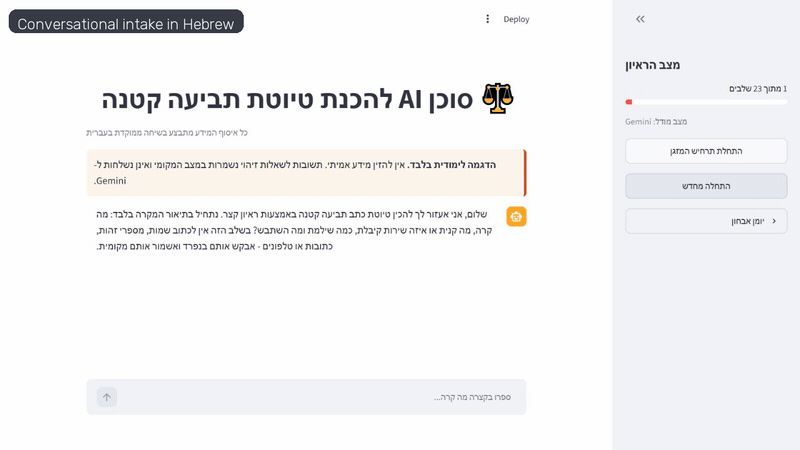
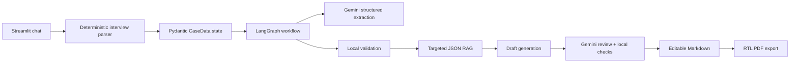

# Israeli Small Claims AI Agent

An end-to-end Hebrew conversational assistant that interviews a user, validates an Israeli small-claims case, retrieves a narrowly scoped set of legal sources, generates an editable court draft, and exports a right-to-left PDF plus a separate source/quality report.

> Educational portfolio project only. It is not legal advice and must not be used with real personal data without an appropriate privacy and security review.

The interface and generated claim are in Hebrew because the target workflow is the Israeli Small Claims Court. The engineering documentation below is in English for portfolio readability.

## Demo

[Watch the recorded walkthrough](docs/demo.mp4) · [Open the deterministic sample claim](output/pdf/demo_small_claim_court_draft.pdf) · [Open its source and quality report](output/pdf/demo_ai_sources_and_quality_report.pdf)



## What the project demonstrates

- A chat-only onboarding flow with one focused question at a time.
- Structured state and validation with Pydantic rather than free-form prompt memory.
- LangGraph orchestration for extraction, validation, targeted retrieval, drafting, and review.
- Gemini structured output with deterministic parsers, bounded retries, and a local fallback.
- Targeted RAG over a small, auditable JSON knowledge base; no vector database is needed.
- Hebrew RTL PDF generation with an embedded open-source font.
- Separation between a clean court draft and an optional AI source/quality report.
- Editable Markdown before final PDF export.
- Privacy guards: dedicated identity fields stay local, outbound state is redacted, and the opening message is scanned for likely personal identifiers before any model call.

## Architecture



LangGraph owns the model-facing workflow: extraction, clarification routing, retrieval, drafting, and review. The conversational interview itself is deliberately deterministic so a model failure cannot erase accepted answers or trap the user in an uncontrolled agent loop.

## Main technology choices

| Technology | Why it is used | Main alternative considered |
|---|---|---|
| Streamlit | Fast, Python-only chat UI and file downloads for an MVP | FastAPI + React offers more production control at higher implementation cost |
| LangGraph | Explicit state transitions and inspectable model workflow | A multi-agent design adds coordination complexity without helping this mostly sequential process |
| Gemini API | Free-tier model access and structured output for the assignment | OpenAI or Claude; both can replace the adapter but were unnecessary for the cost constraint |
| LangChain Google GenAI | Typed integration between Gemini and the graph | Direct SDK calls are lighter but require more orchestration code |
| Pydantic | The `CaseData` schema and validation boundary for model/user data | Plain dictionaries are simpler but less safe and harder to audit |
| JSON targeted RAG | Small, transparent and version-controlled legal source set | A vector database is unnecessary for this narrow corpus |
| ReportLab + python-bidi | Local, deterministic Hebrew PDF export | WeasyPrint/Chromium provide richer CSS but add system dependencies |

## Run locally

Requires Python 3.11 or newer.

```powershell
python -m venv .venv
.\.venv\Scripts\Activate.ps1
pip install -r requirements.txt
Copy-Item .env.example .env
# Add your free GEMINI_API_KEY to .env
streamlit run app.py
```

The default model is configured through `GEMINI_MODEL`. Persistent diagnostic file logging is disabled by default. Set `ENABLE_DIAGNOSTIC_FILE_LOG=1` only for local debugging; logs are ignored by Git.

## Tests and reproducible outputs

```powershell
pytest -q
python scripts/generate_artifacts.py
python scripts/comprehensive_smoke_test.py
python scripts/deep_audit_test.py
```

To rebuild the portfolio walkthrough from captured app screenshots:

```powershell
pip install -r requirements-dev.txt
python scripts/build_demo_video.py
```

There are two intentionally different kinds of sample output:

1. `scripts/generate_artifacts.py` creates the reproducible deterministic example. It does **not** call Gemini. The report labels this fact, and the draft must pass the same local validation used by the application.
2. `scripts/generate_four_live_tool_pdfs.py` and `scripts/generate_rental_tool_run.py` run preset fictional interviews through a configured Gemini API and save sanitized metadata under `output/examples/`. They refuse to claim a live model run when the API key is unavailable.

All names, contact details and identifiers in the included examples are fictional.

## Output gallery

| Scenario | PDF |
|---|---|
| Deterministic air-conditioner example | [Court draft](output/pdf/demo_small_claim_court_draft.pdf) |
| Source and quality-control appendix | [AI report](output/pdf/demo_ai_sources_and_quality_report.pdf) |
| Online course cancellation | [Live-tool example](output/pdf/tool_run_online_course_cancellation.pdf) |
| Moving service no-show | [Live-tool example](output/pdf/tool_run_moving_service_no_show.pdf) |
| Broken laptop | [Live-tool example](output/pdf/tool_run_broken_laptop.pdf) |
| Duplicate restaurant charge | [Live-tool example](output/pdf/tool_run_restaurant_duplicate_charge.pdf) |
| Rental deposit | [Live-tool example](output/pdf/tool_run_rental_claim.pdf) |

## Privacy and legal-source boundaries

- Identification and contact answers are collected in dedicated local-only fields and redacted from model context.
- The first free-text message is screened for common PII patterns before any Gemini call. This is a safety guard, not a guarantee against every possible identifier.
- In-session diagnostics contain parser decisions, not message content. Persistent log files are opt-in.
- The legal knowledge base is small and manually curated. Every record labels whether it is an official primary source, official guidance, or a public consolidation, and whether the stored text is a quotation or a summary.
- Retrieved law is contextual support, not a legal conclusion. The user must verify current law, jurisdiction, evidence, and remedies before filing.

## Repository structure

```text
app.py                         Streamlit chat and draft editor
small_claims_agent/
  models.py                    Pydantic state schemas
  interview.py                 Deterministic interview and correction flow
  graph.py                     LangGraph orchestration
  llm.py                       Gemini adapter and local fallback
  validators.py                Eligibility, arithmetic and draft checks
  privacy.py                   Redaction and opening PII guard
  legal.py / legal_kb.json     Targeted legal retrieval
  drafting.py                  Court draft and source report composition
  pdf_export.py                Hebrew RTL PDF export
scripts/                       Reproducible artifacts and smoke/audit tools
tests/                         Unit, integration and deep-smoke tests
output/                        Portfolio-ready Markdown and PDF examples
docs/                          Screenshot and recorded walkthrough
```

## Known production gaps

This is a polished MVP, not a production legal service. Production work would include authenticated encrypted persistence, a maintained legal-content pipeline, accessibility and cross-browser testing, observability without sensitive data, rate limiting, deployment hardening, and professional legal/privacy review.

## License

Code is released under the [MIT License](LICENSE). The bundled Rubik font is licensed separately under the SIL Open Font License; see [third-party notices](THIRD_PARTY_NOTICES.md).
